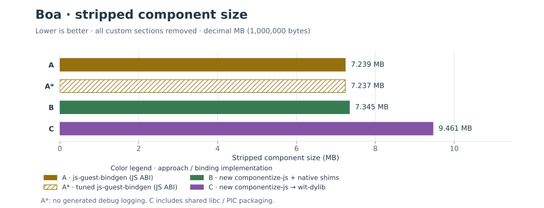
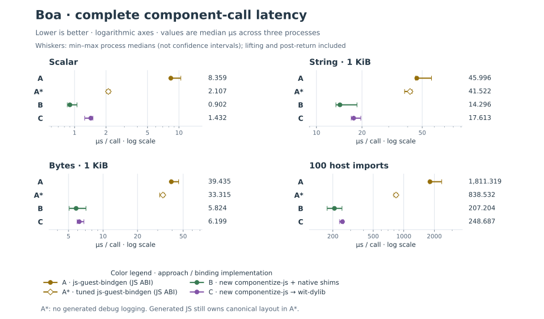
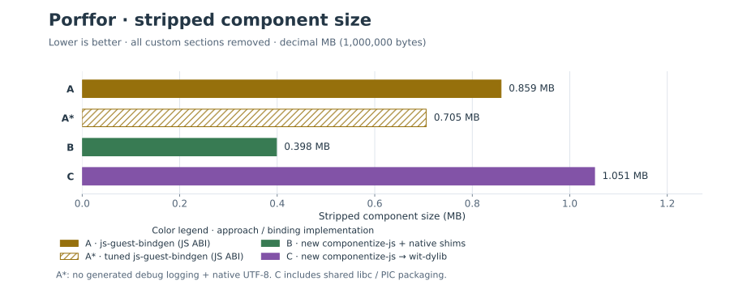
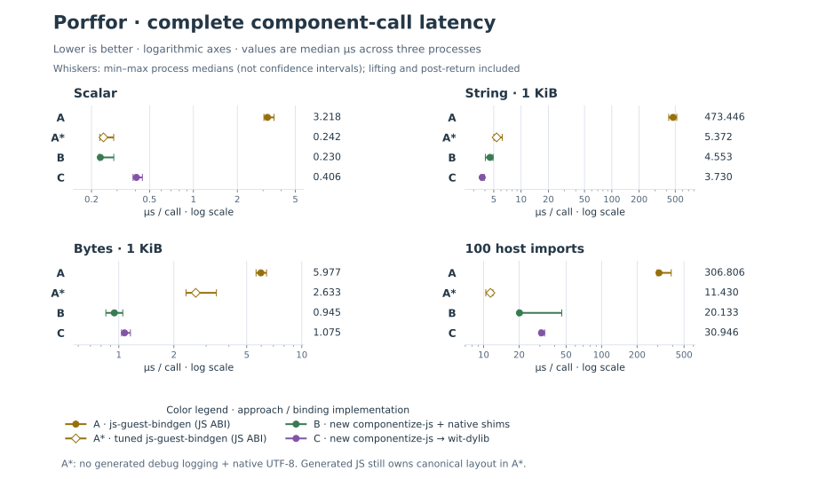
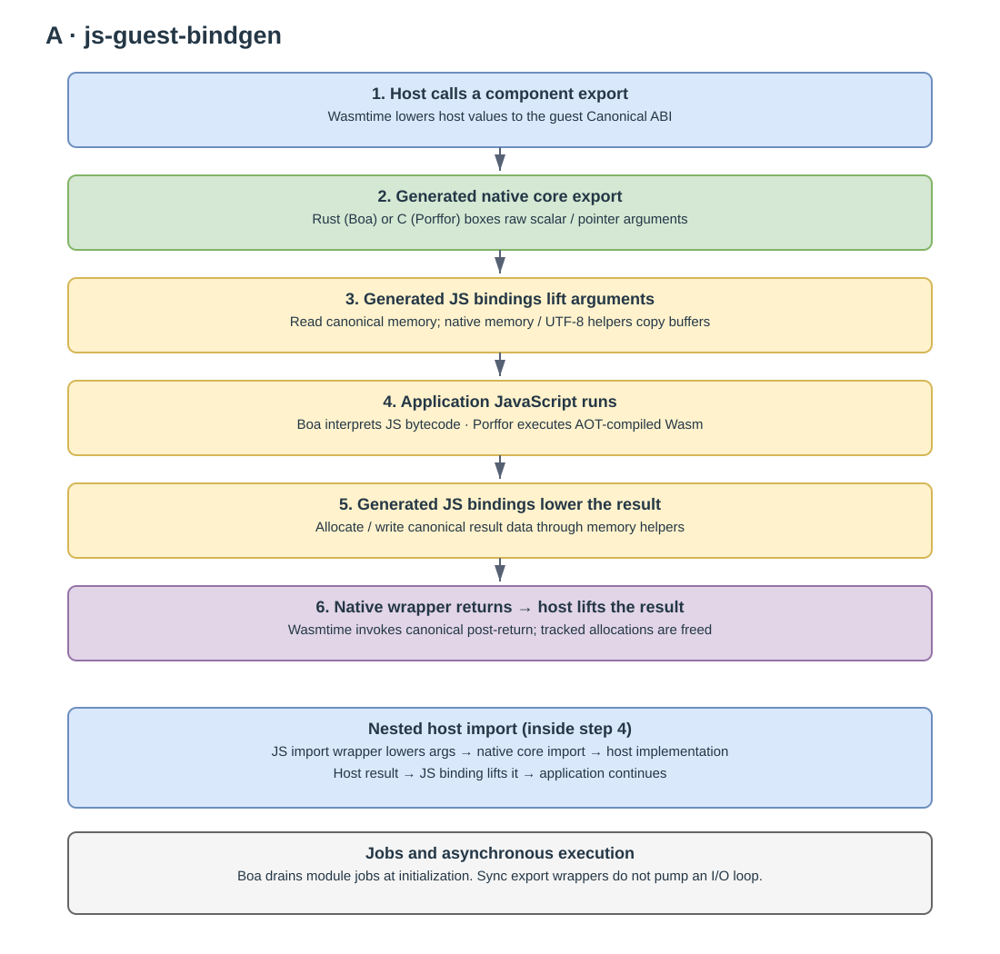
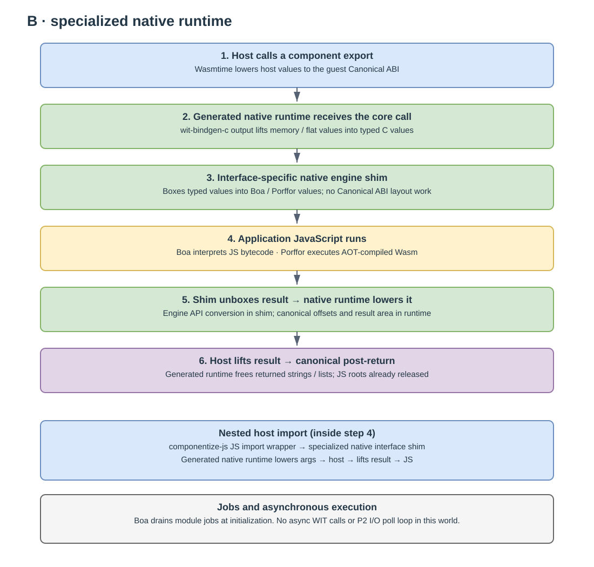
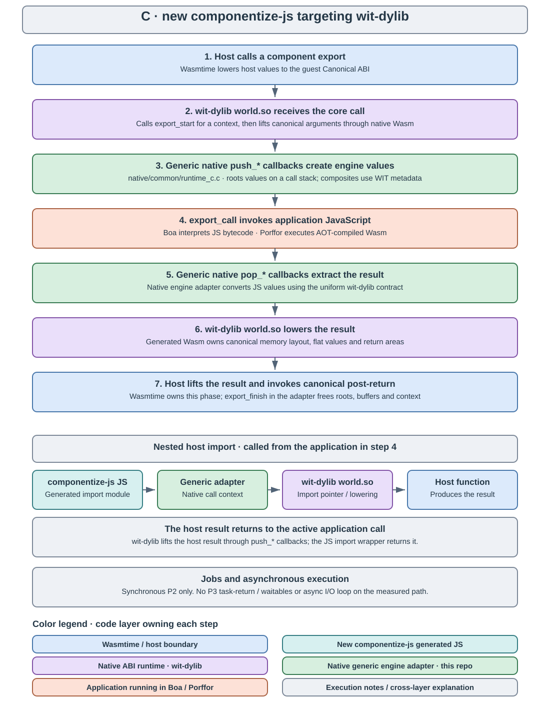

# P2 JavaScript component bindings comparison

This monorepo compares **A: js-guest-bindgen**, **B: new componentize-js machinery + native engine shims**, and **C: new componentize-js targeting wit-dylib**, using **Boa 0.22.0** and a pinned **Porffor**. “New componentize-js” refers to the reboot in the pinned [dicej/componentize-js](https://github.com/dicej/componentize-js/tree/ffa945621842c27c4dd992bed54ecc4375de5b49) checkout. [SUMMARY.md](SUMMARY.md) contains measurements and call-path diagrams; [PROMPT.md](PROMPT.md) preserves the original request.

The experiment measures executable P2 components, with identical [WIT](wit/world.wit), [application JS](packages/app/app.js), host functions, and correctness checks. It is a scoped implementation for this benchmark world, not a complete general-purpose replacement for either project. It deliberately does not infer costs for unimplemented WIT kinds. The engines are the only two requested: Boa interprets the application and generated bindings; Porffor compiles them ahead of time to C and Wasm. Node is used only during the build.

## Architectures

| Approach | Canonical lifting/lowering | Engine interface | Expected tradeoff to measure |
|---|---|---|---|
| A | Generated JS from the actual js-guest-bindgen | Raw core arguments plus native memory/UTF-8 helpers | Minimal engine integration; interpreted conversion can be expensive on Boa; AOT may remove some overhead on Porffor, but also compiles helper code into the binary |
| B: new componentize-js + native engine shims | Generated native C runtime from wit-bindgen-c | Interface-specific native typed shims, separate from canonical layout code | Direct paths and static dead-code elimination; rebuilding native shims for each world; more backend implementation work |
| C: new componentize-js → wit-dylib | Actual wit-dylib-generated world.so | General native push/pop stack contract and WIT metadata | Engine/world decoupling and reusable engine library; dynamic-linking, metadata, call-context and generic callback costs |

B and C reuse the unmodified engine-independent `src/codegen.rs` from the componentize-js reboot to generate import modules and runtime JS. That upstream runtime itself is mozjs-specific, so its synchronous native contract is ported; it is not secretly run on another engine. B adds a specialization backend because upstream componentize-js currently targets wit-dylib. There is no existing engine-neutral “runtime generator” to simply point at Boa or Porffor. [PORTING.md](docs/PORTING.md) explains exactly what was reused and implemented.

B's [native shims](native/common/shims_b.c) accept typed C WIT values and box/unbox them through engine APIs. The separately generated `build/generated/bench.c` receives the raw core export, handles canonical offsets and return areas, and implements post-return. The shims never interpret canonical memory layouts. C's [runtime adapter](native/common/runtime_c.c) implements wit-dylib's generic value-stack callbacks; actual canonical conversion stays in `build/generated/world.so`. The [Boa](crates/boa-native/src/lib.rs) and [Porffor](native/porffor/engine.c) engine operations are reused between B and C.

A's native wrappers and memory preludes derive from the upstream examples. Their generated JS performs canonical conversion. Both engines copy strings and lists; none of these measurements claim zero-copy access to linear memory. On Porffor, generated JS is native machine work after compilation; “JS-side” does not mean “interpreted.”

<!-- BEGIN GENERATED RESULTS -->
## Results at a glance

**JS-side lifting/lowering is not an automatic size or speed win.** The tables below compare A/B/C within each engine. B means **new componentize-js machinery + native engine shims**; C means **new componentize-js targeting wit-dylib**.

Sizes are stripped decimal MB; timings are µs per complete component call, including result lifting and post-return. Each timing is the median of three process medians. A* is a diagnostic A build that keeps canonical layout conversion in JS.

### Boa

A*: no generated debug logging.

| Approach | Stripped MB | Scalar µs | String 1 KiB µs | Bytes 1 KiB µs | 100 imports µs |
|---|---:|---:|---:|---:|---:|
| A | 7.239 | 8.359 | 45.996 | 39.435 | 1,811.319 |
| A* | 7.237 | 2.107 | 41.522 | 33.315 | 838.532 |
| B | 7.345 | 0.902 | 14.296 | 5.824 | 207.204 |
| C | 9.461 | 1.432 | 17.613 | 6.199 | 248.687 |

Native B/C are substantially faster on these calls, including against A*. A is only **1.4% smaller than B**; C is **28.8% larger than B**.





### Porffor

A*: no generated debug logging + native UTF-8.

| Approach | Stripped MB | Scalar µs | String 1 KiB µs | Bytes 1 KiB µs | 100 imports µs |
|---|---:|---:|---:|---:|---:|
| A | 0.859 | 3.218 | 473.446 | 5.977 | 306.806 |
| A* | 0.705 | 0.242 | 5.372 | 2.633 | 11.430 |
| B | 0.398 | 0.230 | 4.553 | 0.945 | 20.133 |
| C | 1.051 | 0.406 | 3.730 | 1.075 | 30.946 |

A* matches B's scalar range and is faster on the import loop. B is faster on byte lists and **43.5% smaller** than A* (**53.6% smaller than default A**). C is **163.7% larger than B**, but is faster in the measured 1 KiB string case.





C's deployment-size gap includes shared libc, PIC and linking scaffolding; it is not the cost of generic conversion alone. Latency graphs use **logarithmic axes**, with min–max process medians as whiskers, not confidence intervals. Small differences and overlapping ranges on this shared host are inconclusive. These results cover the declared synchronous P2 world, not general Promise/I/O workloads.

See [SUMMARY.md](SUMMARY.md) for all controls, cold behavior and qualifications, and [results/TABLES.md](results/TABLES.md) for all measured cases. SVG charts use embedded light/dark styles and include an approach legend. Regenerate the charts and this section with `python3 scripts/figures.py` after installing `scripts/requirements-figures.txt`.
<!-- END GENERATED RESULTS -->

## Call paths and jobs





The exact initialization, result, and future scheduler contracts are described in [ASYNC.md](docs/ASYNC.md). Each diagram has a color legend identifying the code layer that owns each step; colors distinguish generated bindings, native ABI runtime, engine shims, application execution and the host boundary. SVGs adapt to light/dark color schemes and retain an explicit background for contrast. Editable `.drawio` files sit beside them. Run `python3 scripts/diagrams.py` to regenerate both from the same source.

These WIT exports/imports are synchronous P2 calls. Boa drains jobs during ES-module initialization. The application returns plain values, so measured exports do not wait on promises. Porffor runs compiled synchronous functions. There is no I/O polling loop in this workload. A future P2 async application adapter would have to drain engine jobs, service WASI pollables, settle/reject the application's promise, and only then return its synchronous WIT result; none of that should be confused with the P3 task-return/waitable path in upstream componentize-js.

Wasmtime 50 lifts the result and invokes canonical post-return within `TypedFunc::call`. B's runtime frees output buffers there; C calls `export_finish` to free temporary buffers and roots; A's wrapper frees its tracked result allocations. Nested imports complete synchronously and return to the active JS call.

## Layout

- `upstream/`: pinned Git submodules, with revisions and tool versions in `upstream.lock.json`.
- `vendor/componentize-codegen/`: unchanged componentize-js generator and its license.
- `crates/generate/`: reuses js-guest-bindgen, componentize-js codegen, wit-bindgen-c and wit-dylib.
- `crates/boa-a/`, `crates/boa-native/`: Boa adapters.
- `native/common/`, `native/porffor/`: shared native contracts and Porffor API integration.
- `packages/app/`, `wit/`: identical guest and interface for all six cells.
- `crates/runner/`: Wasmtime host, correctness oracle, cold and warm timing.
- `scripts/`: bootstrap, build, measurement/report, diagram generation.
- `build/`: ignored generated source, components and local logs.
- `results/`: raw samples, artifact hashes, environment and size breakdowns.

## Reproduce

On x86-64 Linux, with Rustup, Node, Python 3 and Git:

```sh
./scripts/bootstrap.sh
python3 scripts/build.py
CARGO_TARGET_DIR=target/host cargo build --locked --release -p runner
python3 scripts/ablations.py  # three diagnostic A controls
python3 scripts/verify.py
python3 scripts/measure.py
python3 scripts/report.py
python3 scripts/summary.py
```

`WASI_SDK_PATH` can point to an existing WASI SDK 30. Build a subset with `python3 scripts/build.py boa-a porffor-c`. The bootstrap downloads pinned tool versions; it does not install an alternate JS engine. Full source builds need several GB of free disk. Build logs are ordinary subprocess output and can be redirected to `build/logs/`.

The commands above reproduce the full nine-build report. Measurement replaces the corresponding files under `results/`; preserve that directory separately before collecting a different dataset. The narrative in `SUMMARY.md` describes the checked-in experiment, so review its conclusions when regenerating tables on another machine. The Porffor submodule has one intentional local modification, recorded in `patches/porffor-wasi.patch` and applied by bootstrap.

To regenerate the documentation visuals, install `scripts/requirements-figures.txt` in a Python environment with pip, then run `python3 scripts/diagrams.py` and `python3 scripts/figures.py`. Chart generation was verified with Python 3.14 and Matplotlib 3.10.7. The figure script reads the saved measurements and updates the marked README results section; it does not rerun benchmarks. The standalone call-path generator uses only the Python standard library.

## Method and limits

The common workloads cover u32 boundaries, fractional f64, ASCII and Unicode/NUL strings, byte lists (0 through 16 KiB), a mixed record, and synchronous host round trips. Correctness runs before timing. Warm timing includes the Wasmtime component boundary, input cloning, JS work, output lifting, automatic post-return, and output destruction. Import batches expose guest-to-host boundary costs. Cold measurements separate instantiation from the first scalar call after instantiation; compilation is reported separately and excluded from both.

The same release optimization setting is used within an engine. All guest links use WASI SDK 30 libc; `scripts/wasi-static-linker.py` makes Boa A/B static reactors against that SDK rather than Rust's bundled libc. C requires PIC/shared linking, and includes SDK shared libc; B and A are statically linked. That is a real deployment difference, but it prevents assigning the entire C size delta to generic lifting/lowering. Stripped and deterministically gzip-compressed sizes are more relevant than debug-bearing build sizes. Engine library and generated binding sizes are also reported separately. No snapshots or cross-component engine-code cache are used, so C's potential engine reuse benefit is unmeasured.

The adapters support exactly the tested WIT subset. Unsupported C callbacks trap; B's typed shims are explicit for this world. Resources, options/results, variants, 64-bit values, promise-returning application exports, I/O, and P3 are outside the measurement. This limits extrapolation to full applications. Matching type validation for arbitrary malformed JS values and generalized shim code generation are follow-up engineering work, not silently assumed features of the benchmark.

## Interpreting the comparison

`wit-dylib` generates native Wasm specialized to the WIT world. Its generality is at the engine integration boundary: a uniform push/pop API, metadata for composite values, and per-call state. It does **not** repeatedly parse WIT or interpret the entire Canonical ABI from scratch on every call. B removes that generic boundary; B and C both still need to convert values to the engine's representation.

Two diagnostic controls help separate implementation choices from ABI placement. `boa-a-nolog` and `porffor-a-nolog` remove only generated `_debugLog(...)` expression statements, including their otherwise-allocated argument objects. `porffor-a-native-utf8` additionally replaces UTF-8 intrinsics with the same native string routines used by B/C; canonical layout conversion remains in generated JS. These are explicitly modified A builds, not upstream defaults. Their correctness checks and raw measurements use the same runner. Logging removal uses Porffor's parser to locate expression statements, not a text substitution over arbitrary JS.

Primary code references: [js-guest-bindgen's contract](https://github.com/MendyBerger/js-guest-bindgen/blob/d3d18ccf193ced5140511f1ad44a7b3830869770/ARCHITECTURE.md), [componentize-js's generator](https://github.com/dicej/componentize-js/blob/ffa945621842c27c4dd992bed54ecc4375de5b49/src/codegen.rs), [componentize-js's native runtime](https://github.com/dicej/componentize-js/blob/ffa945621842c27c4dd992bed54ecc4375de5b49/runtime/src/lib.rs), and [wit-dylib's generated-library contract](https://github.com/bytecodealliance/wasm-tools/blob/v1.254.0/crates/wit-dylib/wit_dylib.h).
